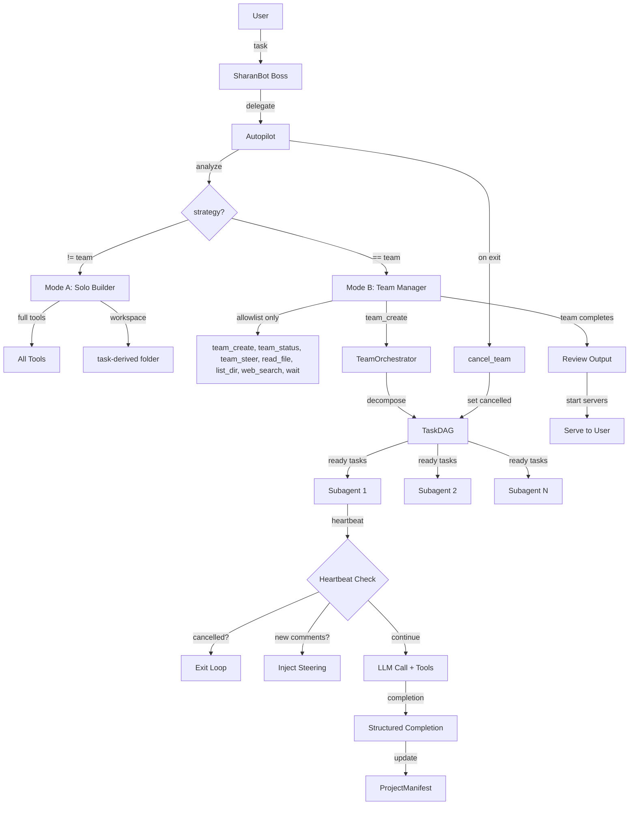

# Design Document: Team Orchestration Overhaul

## Overview

This design addresses the fundamental split-brain failure mode discovered across 4 rounds of E2E testing: the Autopilot simultaneously acts as manager AND builder when team strategy is active, creating two competing codebases. The overhaul introduces two mutually exclusive execution modes, heartbeat-based subagent lifecycle management, atomic task checkout, task-based communication, and fixes 12 specific bugs.

The core insight from E2E testing and Paperclip's architecture: when you give an agent all the tools to build AND tell it to manage a team, it will always get impatient and build directly. The fix is enforcing mode exclusivity at the tool-definitions level — not via prompt hints.

### Key Design Decisions

1. **Allowlist over blocklist**: Mode B uses an explicit allowlist of permitted tools rather than a blocklist of denied tools. This is safer — new tools are denied by default.
2. **Heartbeat check-in over fire-and-forget**: Subagents check in with the parent team each iteration, inspired by Paperclip's heartbeat model. This enables cancellation, steering injection, and zombie prevention.
3. **Task comments over TeamBus**: Steering messages are stored on TaskNode objects (persistent, readable at any time) rather than pushed through asyncio queues (transient, easily missed).
4. **Subagent-only execution**: GSD workers are removed entirely. The Node.js loader never existed, and every GSD call falls back to subagents anyway.
5. **Early consolidation**: Token summarization triggers at 60% instead of 80%, preserving more context window for actual work.

## Architecture

The overhaul restructures the Autopilot → TeamOrchestrator → Subagent hierarchy into two clean, mutually exclusive paths:



### Mode A: Solo Builder
- Autopilot has full tool access (write_file, exec, create_software, etc.)
- No team created, no DAG, no subagents
- Workspace is a folder derived from the task name, created before first tool call
- ProjectManifest tracks files and decisions for the Autopilot's own work

### Mode B: Team Manager
- Autopilot tool definitions are filtered to an explicit allowlist: `team_create`, `team_status`, `team_steer`, `read_file`, `list_dir`, `web_search`, `wait`
- All build tools are physically absent from the LLM tool definitions — the LLM cannot call them
- Team subagents do all building via `_run_task_as_subagent`
- Subagents check in via heartbeat each iteration
- On Autopilot exit, `cancel_team()` kills all running subagents


## Components and Interfaces

### 1. Autopilot Mode Enforcement (`autopilot.py`)

The `execute()` method gains mode-aware tool filtering:

```python
# In Autopilot.execute(), before the main loop:

MODE_B_ALLOWLIST = frozenset({
    "team_create", "team_status", "team_steer",
    "read_file", "list_dir", "web_search", "web_fetch",
    "wait",
})

if decision.strategy == "team":
    # Mode B: allowlist filtering at tool-definitions level
    tool_defs = [
        t for t in self._tools.get_definitions()
        if t.get("function", {}).get("name") in MODE_B_ALLOWLIST
    ]
else:
    # Mode A: full tool access
    tool_defs = self._tools.get_definitions()
```

The existing blocklist approach in `execute()` is replaced entirely. The current code filters with `_blocked_tools` set — this is insufficient because new tools bypass the blocklist. The allowlist approach ensures only explicitly permitted tools are available.

On Autopilot completion, if a team was created:

```python
# At the end of Autopilot.execute():
if decision.strategy == "team" and self._team_orchestrator:
    for team_id, session in self._team_orchestrator.teams.items():
        if session.status == "running":
            await self._team_orchestrator.cancel_team(team_id)
```

### 2. Heartbeat Check-In (`orchestrator.py`)

Each subagent iteration in `_run_task_as_subagent` begins with a heartbeat check:

```python
async def _heartbeat_check(
    self, session: TeamSession, task: TaskNode, agent_id: str
) -> tuple[str, list[dict]]:
    """Check parent team status and collect new steering comments.
    
    Returns:
        ("continue" | "exit", list_of_new_comment_messages)
    """
    # 1. Check team cancellation
    if session.status in ("cancelled", "completed"):
        return "exit", []
    
    # 2. Check task reassignment via checkout
    checkout_holder = self._task_checkouts.get(task.id)
    if checkout_holder and checkout_holder != agent_id:
        return "exit", []
    
    # 3. Collect unread comments from TaskNode
    new_messages = []
    unread = task.comments[task._last_read_index:]
    task._last_read_index = len(task.comments)
    for comment in unread:
        new_messages.append({
            "role": "user",
            "content": f"[Team Steering from {comment.get('from', 'orchestrator')}] {comment.get('content', '')}",
        })
    
    return "continue", new_messages
```

This replaces the current `bus.get_pending()` call. The heartbeat check is O(1) for cancellation detection and O(k) for k new comments — well within the 10ms target.

### 3. Atomic Task Checkout (`orchestrator.py`)

```python
class TeamOrchestrator:
    def __init__(self, ...):
        ...
        self._task_checkouts: dict[str, str] = {}  # task_id → agent_id
    
    def checkout_task(self, task_id: str, agent_id: str) -> bool:
        """Atomically claim a task. Returns False if already held by another agent."""
        current = self._task_checkouts.get(task_id)
        if current and current != agent_id:
            logger.warning("Task {} already checked out by {}, {} blocked", task_id, current, agent_id)
            return False
        self._task_checkouts[task_id] = agent_id
        return True
    
    def release_task(self, task_id: str) -> None:
        """Release a task checkout."""
        self._task_checkouts.pop(task_id, None)
```

Called in `_execute_task` before spawning the subagent, and in the `finally` block after completion/failure.

### 4. TaskNode Comments (`dag.py`)

```python
@dataclass
class TaskNode:
    # ... existing fields ...
    comments: list[dict[str, Any]] = field(default_factory=list)
    _last_read_index: int = 0  # per-agent read cursor (reset on assignment)
```

Comments are dicts with `from`, `content`, `timestamp` keys. The `_last_read_index` tracks how far the assigned agent has read, so heartbeat checks only return unread comments.

### 5. Task-Based Steering (`orchestrator.py`)

```python
async def steer_team(self, team_id: str, instruction: str) -> str:
    session = self.teams.get(team_id)
    if not session:
        return f"Team {team_id} not found."
    
    # Append comment to all running/pending tasks
    comment = {
        "from": "orchestrator",
        "content": instruction,
        "timestamp": time.time(),
    }
    targeted = 0
    for task in session.dag.tasks.values():
        if task.status in ("running", "pending"):
            task.comments.append(comment)
            targeted += 1
    
    return f"Instruction delivered to {targeted} active tasks in team {team_id}."
```

This replaces `bus.broadcast()`. Comments persist on the TaskNode and are read during heartbeat checks.

### 6. cancel_team() Enhancement (`orchestrator.py`)

The existing `cancel_team()` is enhanced to track and cancel asyncio tasks:

```python
@dataclass
class TeamSession:
    # ... existing fields ...
    _task_handles: list[asyncio.Task] = field(default_factory=list)

# In _execute_task_throttled, track the task handle:
async def _execute_task_throttled(self, session, task):
    handle = asyncio.current_task()
    if handle:
        session._task_handles.append(handle)
    try:
        async with self._concurrency_sem:
            await self._execute_task(session, task)
    finally:
        if handle and handle in session._task_handles:
            session._task_handles.remove(handle)

async def cancel_team(self, team_id: str) -> str:
    session = self.teams.get(team_id)
    if not session:
        return f"Team {team_id} not found."
    session.status = "cancelled"
    session.bus.clear()
    # Cancel all running asyncio tasks
    for handle in list(session._task_handles):
        if not handle.done():
            handle.cancel()
    # Release all checkouts for this team
    team_task_ids = set(session.dag.tasks.keys())
    for tid in team_task_ids:
        self._task_checkouts.pop(tid, None)
    logger.info("Team {} cancelled", team_id)
    return f"Team {team_id} cancelled."
```

### 7. Wait Tool (`tools/wait.py`)

```python
class WaitTool(Tool):
    name = "wait"
    description = "Wait/sleep for a specified duration in seconds. Max 300s."
    parameters = {
        "type": "object",
        "properties": {
            "seconds": {"type": "number", "description": "Duration to wait in seconds (max 300)"}
        },
        "required": ["seconds"],
    }
    
    async def execute(self, seconds: float = 10, **kwargs) -> str:
        duration = min(max(0, seconds), 300)
        await asyncio.sleep(duration)
        return f"Waited {duration:.1f} seconds."
```

### 8. Project Name Derivation Fix (`manifest.py`)

```python
@staticmethod
def _derive_project_name(task: str, team_id: str) -> str:
    import re
    # Strip emoji and unicode symbols
    task_clean = re.sub(
        r'[\U00010000-\U0010ffff\u2600-\u27bf\u2300-\u23ff\u2b50-\u2bff\u200d\ufe0f\u2014\u2013]',
        '', task
    )
    task_lower = task_clean.lower().strip()
    
    # Try verb-based pattern
    for pattern in [
        r"(?:build|create|develop|make|implement)\s+(?:a\s+|an\s+|the\s+)?(.+?)$",
    ]:
        match = re.search(pattern, task_lower)
        if match:
            name = match.group(1).strip()
            for suffix in [" app", " application", " website", " web app",
                           " project", " system", " tool", " platform",
                           " from scratch", " for me", " please"]:
                if name.endswith(suffix):
                    name = name[:-len(suffix)].strip()
            name = name[:40]
            name = re.sub(r"[^\w\s-]", "", name)
            name = re.sub(r"\s+", "-", name).strip("-")
            if name and len(name) >= 2:
                return name
    
    # Fallback: extract first 3 significant words
    stop_words = {"a", "an", "the", "is", "it", "to", "for", "and", "or", "of",
                  "in", "on", "at", "by", "with", "from", "me", "my", "please",
                  "master", "prompt", "production", "ready"}
    words = re.sub(r"[^\w\s]", "", task_lower).split()
    significant = [w for w in words if w not in stop_words and len(w) > 1][:3]
    if significant:
        name = "-".join(significant)[:40]
        if len(name) >= 2:
            return name
    
    return f"project-{team_id}"
```

### 9. Port Pre-Assignment Fix (`manifest.py`)

```python
_DEFAULT_PORT_RANGE = (8000, 9000)  # Changed from (3000, 9000)

def assign_port(self, service: str) -> int:
    if service in self.ports:
        # Verify existing assignment is still free
        if self._is_port_free(self.ports[service]):
            return self.ports[service]
        # Port occupied — reassign
        del self.ports[service]
    
    used = set(self.ports.values())
    port = self._find_free_port(exclude=used)
    self.ports[service] = port
    self.save()
    return port

@staticmethod
def _is_port_free(port: int) -> bool:
    try:
        with socket.socket(socket.AF_INET, socket.SOCK_STREAM) as s:
            s.bind(("127.0.0.1", port))
            return True
    except OSError:
        return False
```

### 10. SessionManager._sessions Fix (`agent/loop.py`)

In `sharanbot/agent/loop.py` line 516, change:
```python
# Before (bug):
for key in reversed(list(self.sessions._sessions.keys())):
# After (fix):
for key in reversed(list(self.sessions._cache.keys())):
```

### 11. Token Consolidation at 60% (`autopilot.py`)

In `Autopilot.execute()`, change the threshold:
```python
# Before:
threshold = int(self._context_window_tokens * 0.80)
# After:
threshold = int(self._context_window_tokens * 0.60)
```

### 12. Manifest Tracking Improvements (`orchestrator.py`)

Enhanced `_update_manifest_from_tool`:

```python
@staticmethod
def _update_manifest_from_tool(manifest, agent_id, tool_name, arguments):
    try:
        # Track file writes
        write_tools = {"write_file", "edit_file", "mcp_filesystem_write_file", "mcp_filesystem_edit_file"}
        if tool_name in write_tools:
            filepath = arguments.get("path") or arguments.get("file_path") or ""
            if filepath:
                manifest.claim_files(agent_id, [filepath])
        
        # Track architecture decisions from exec commands
        if tool_name == "exec":
            cmd = arguments.get("command", "")
            decision_patterns = [
                ("npm init", "Initialized npm project"),
                ("npx create-", "Scaffolded project"),
                ("pip install", "Installed Python dependencies"),
                ("npm install", "Installed npm dependencies"),
                ("cargo init", "Initialized Rust project"),
                ("go mod init", "Initialized Go module"),
                ("dotnet new", "Scaffolded .NET project"),
                ("django-admin startproject", "Created Django project"),
                ("rails new", "Created Rails project"),
                ("vite create", "Scaffolded Vite project"),
            ]
            for pattern, desc in decision_patterns:
                if pattern in cmd:
                    manifest.record_decision(agent_id, f"{desc}: {cmd[:100]}")
                    break
        
        # Track config file writes as architecture decisions
        if tool_name in write_tools:
            filepath = arguments.get("path") or arguments.get("file_path") or ""
            config_patterns = {
                "vite.config": "Configured Vite",
                "tsconfig": "Configured TypeScript",
                "Dockerfile": "Added Docker configuration",
                "docker-compose": "Added Docker Compose",
                ".eslintrc": "Configured ESLint",
                "webpack.config": "Configured Webpack",
                "next.config": "Configured Next.js",
                "tailwind.config": "Configured Tailwind CSS",
            }
            for pattern, desc in config_patterns.items():
                if pattern in filepath:
                    manifest.record_decision(agent_id, f"{desc}: {filepath}")
                    break
    except Exception as e:
        logger.debug("Manifest update failed for {}: {}", tool_name, e)
```

### 13. Workspace Resolution (`autopilot.py`)

Before the main execution loop in `execute()`:

```python
# Resolve workspace before any tool calls
if decision.strategy == "team":
    # Mode B: workspace will be set by team_create → project_root
    # Autopilot doesn't write files, so no workspace needed
    pass
else:
    # Mode A: create workspace from task name
    project_name = ProjectManifest._derive_project_name(task, "solo")
    workspace = self.workspace / project_name if self.workspace else None
    if workspace:
        workspace.mkdir(parents=True, exist_ok=True)
    # Update tool working directories to point to this workspace
```

### 14. Structured Task Completion (`orchestrator.py`)

Subagent system prompt includes a completion format instruction:

```python
COMPLETION_FORMAT = """
When you have completed your task, end your final response with a structured summary:

## Task Completion
- **Files created/modified**: [list of file paths]
- **Architecture decisions**: [key choices made]
- **Summary**: [brief description of what was built]
"""
```

The orchestrator parses this from the subagent's final response and updates the manifest:

```python
def _parse_completion_report(self, result: str, manifest, agent_id: str):
    """Extract structured completion data from subagent response."""
    if "## Task Completion" in result:
        # Parse files
        files_match = re.search(r"Files created/modified.*?:\s*(.+?)(?:\n-|\n##|\Z)", result, re.DOTALL)
        if files_match:
            files = re.findall(r'[`"]?([^\s,`"]+\.\w+)[`"]?', files_match.group(1))
            manifest.claim_files(agent_id, files)
        
        # Parse decisions
        decisions_match = re.search(r"Architecture decisions.*?:\s*(.+?)(?:\n-|\n##|\Z)", result, re.DOTALL)
        if decisions_match:
            manifest.record_decision(agent_id, decisions_match.group(1).strip()[:200])
```

### 15. GSD Worker Removal

The following changes remove the non-functional GSD worker system:

1. **`orchestrator.py`**: Remove `_run_task_as_gsd_worker` method entirely. Remove `worker_manager` constructor parameter. Route all tasks through `_run_task_as_subagent`.
2. **`commands.py`**: Remove `WorkerManager` import and instantiation from `gateway()`. Remove `worker_mgr` parameter from `AgentLoop` constructor.
3. **`autopilot.py`**: No changes needed — autopilot doesn't directly use GSD workers.


## Data Models

### Modified: TaskNode (`dag.py`)

```python
@dataclass
class TaskNode:
    id: str
    description: str
    agent_profile: str
    depends_on: list[str] = field(default_factory=list)
    status: str = "pending"
    result: str | None = None
    error: str | None = None
    retry_count: int = 0
    max_retries: int = 3
    agent_id: str | None = None
    started_at: datetime | None = None
    completed_at: datetime | None = None
    quality_gate: bool = False
    on_fail_goto: str | None = None
    metadata: dict[str, Any] = field(default_factory=dict)
    lineage: list[str] = field(default_factory=list)
    # NEW: task-based communication
    comments: list[dict[str, Any]] = field(default_factory=list)
    _last_read_index: int = 0
```

### Modified: TeamSession (`orchestrator.py`)

```python
@dataclass
class TeamSession:
    team_id: str
    task: str
    dag: TaskDAG
    bus: TeamBus
    tracer: TeamTracer
    created_at: datetime = field(default_factory=datetime.now)
    status: str = "running"
    origin_channel: str = "cli"
    origin_chat_id: str = "direct"
    project_root: Path | None = None
    manifest: Any = None
    # NEW: track asyncio task handles for cancellation
    _task_handles: list[asyncio.Task] = field(default_factory=list)
```

### New: WaitTool (`tools/wait.py`)

```python
@dataclass
class WaitToolParams:
    seconds: float  # 0 < seconds <= 300
```

### Modified: ProjectManifest (`manifest.py`)

No structural changes to the data model. Changes are behavioral:
- `_DEFAULT_PORT_RANGE` changes from `(3000, 9000)` to `(8000, 9000)`
- `assign_port()` verifies port availability before returning cached assignments
- `_derive_project_name()` handles emoji stripping and fallback word extraction

### Modified: Autopilot (`autopilot.py`)

New constant:
```python
MODE_B_ALLOWLIST = frozenset({
    "team_create", "team_status", "team_steer",
    "read_file", "list_dir", "web_search", "web_fetch",
    "wait",
})
```

### Modified: TeamOrchestrator (`orchestrator.py`)

New instance variable:
```python
self._task_checkouts: dict[str, str] = {}  # task_id → agent_id
```

Removed:
- `worker_manager` constructor parameter
- `_run_task_as_gsd_worker` method
- All GSD worker references

### Comment Schema

Task comments follow this structure:
```python
{
    "from": str,        # agent_id or "orchestrator"
    "content": str,     # the message
    "timestamp": float, # time.time()
    "type": str,        # "steer" | "completion" | "status"
}
```

Completion comments include structured data:
```python
{
    "from": str,
    "content": str,
    "timestamp": float,
    "type": "completion",
    "files": list[str],
    "decisions": list[str],
    "summary": str,
}
```


## Correctness Properties

*A property is a characteristic or behavior that should hold true across all valid executions of a system — essentially, a formal statement about what the system should do. Properties serve as the bridge between human-readable specifications and machine-verifiable correctness guarantees.*

### Property 1: Mode-based tool filtering

*For any* set of tool definitions and any Autopilot decision, if the strategy is "team" (Mode B), the filtered tool set SHALL contain only tools whose names are in the MODE_B_ALLOWLIST; if the strategy is not "team" (Mode A), the filtered tool set SHALL equal the original unfiltered set. In particular, for Mode B, no build tools (write_file, edit_file, create_software, exec, deploy, etc.) shall be present in the output.

**Validates: Requirements 1.1, 1.2, 1.3**

### Property 2: Heartbeat exits on cancelled or completed session

*For any* TeamSession with status "cancelled" or "completed", and any TaskNode and agent_id, calling `_heartbeat_check(session, task, agent_id)` SHALL return an action of "exit".

**Validates: Requirements 2.2, 5.3**

### Property 3: Heartbeat returns unread comments

*For any* TaskNode with N comments where `_last_read_index` is K (K <= N), calling the heartbeat check SHALL return exactly (N - K) new comment messages, and after the call `_last_read_index` SHALL equal N. If K == N, zero messages are returned.

**Validates: Requirements 2.3, 4.3, 7.3**

### Property 4: Heartbeat exits on task reassignment

*For any* TaskNode checked out by agent_id_A, if the heartbeat check is called with agent_id_B (where B != A), the action SHALL be "exit".

**Validates: Requirements 2.4**

### Property 5: Task checkout round-trip

*For any* task_id and agent_id, calling `checkout_task(task_id, agent_id)` SHALL return True and store the mapping, and subsequently calling `release_task(task_id)` SHALL remove the mapping so that `_task_checkouts` no longer contains task_id.

**Validates: Requirements 3.2, 3.4**

### Property 6: Task checkout mutual exclusion

*For any* task_id already checked out by agent_id_A, calling `checkout_task(task_id, agent_id_B)` where B != A SHALL return False and leave the existing mapping unchanged.

**Validates: Requirements 3.3**

### Property 7: Steer appends comments to active tasks

*For any* TeamSession with a DAG containing tasks in various statuses, calling `steer_team(team_id, instruction)` SHALL append a comment to every task with status "running" or "pending", and SHALL NOT modify tasks with status "completed", "failed", or "skipped".

**Validates: Requirements 4.2, 7.2**

### Property 8: Cancel team sets status to cancelled

*For any* running TeamSession, calling `cancel_team(team_id)` SHALL set `session.status` to "cancelled" and clear the TeamBus.

**Validates: Requirements 5.2**

### Property 9: Project name is filesystem-safe

*For any* input string (including strings with emoji, Unicode symbols, mixed case, punctuation, and whitespace), `_derive_project_name` SHALL return a string that: (a) contains only lowercase alphanumeric characters and hyphens `[a-z0-9-]+`, (b) has length <= 40, (c) is non-empty, and (d) does not start or end with a hyphen.

**Validates: Requirements 8.1, 8.2, 8.4**

### Property 10: Project name fallback extracts significant words

*For any* task description that does not contain the verbs "build", "create", "develop", "make", or "implement" but contains at least 3 significant words (non-stop-words, length > 1), `_derive_project_name` SHALL return a name that is NOT the generic fallback pattern `project-{team_id}`.

**Validates: Requirements 8.3, 8.5**

### Property 11: Assigned ports are bindable

*For any* service name, the port returned by `assign_port(service)` SHALL be bindable on 127.0.0.1 (i.e., not occupied by another process) at the time of assignment, and SHALL be >= 8000.

**Validates: Requirements 9.1, 9.2**

### Property 12: Token consolidation threshold at 60%

*For any* positive integer `context_window_tokens`, the summarization threshold SHALL equal `int(context_window_tokens * 0.60)`.

**Validates: Requirements 11.1, 11.2**

### Property 13: Wait tool duration capping

*For any* requested duration (including negative, zero, and very large values), the wait tool's actual sleep duration SHALL be `min(max(0, requested), 300)`.

**Validates: Requirements 12.3**

### Property 14: Manifest tracks file writes and architecture decisions

*For any* tool call to a write tool (write_file, edit_file, mcp_filesystem_write_file, mcp_filesystem_edit_file) with a non-empty file path, `_update_manifest_from_tool` SHALL add that path to the agent's file claim list. *For any* exec tool call whose command matches a known architecture pattern (npm install, npx create-, pip install, cargo init, go mod init, dotnet new, django-admin startproject, rails new, vite create), a decision entry SHALL be recorded in the manifest. *For any* write to a known config file (vite.config, tsconfig, Dockerfile, etc.), a decision entry SHALL be recorded.

**Validates: Requirements 13.1, 13.2, 13.4**

### Property 15: Completion report parsing extracts files and decisions

*For any* subagent response string containing a "## Task Completion" section with file paths and architecture decisions in the expected format, `_parse_completion_report` SHALL extract those file paths and record them in the manifest's file claims, and SHALL extract decisions and record them in the manifest's decisions list.

**Validates: Requirements 4.5, 15.2**

### Property 16: Consolidated summary includes all task completions

*For any* completed TaskDAG where all tasks have status "completed" with non-empty results, the generated summary SHALL contain a reference to each task's result.

**Validates: Requirements 15.3**

## Error Handling

### Mode Enforcement Errors
- If tool filtering produces an empty tool set (e.g., none of the allowlisted tools are registered), the Autopilot should log a warning and fall back to Mode A with full tools. This prevents a deadlocked Autopilot with no tools.

### Heartbeat Check Errors
- If the heartbeat check raises an exception (e.g., session object corrupted), the subagent should log the error and continue execution rather than crashing. A failed heartbeat is treated as "continue".

### Task Checkout Errors
- If `checkout_task` is called with a None task_id or agent_id, it should return False without modifying state.
- If `release_task` is called for a task_id not in the checkout dict, it should be a no-op.

### Cancel Team Errors
- If `cancel_team` is called for a non-existent team_id, return an error message without raising.
- If asyncio task cancellation raises (e.g., task already done), catch and continue cancelling remaining tasks.
- The 5-second timeout on cancel_team is enforced by not awaiting subagent completion — cancellation is fire-and-forget.

### Project Name Derivation Errors
- If all extraction methods fail (empty input, only stop words, only emoji), fall back to `project-{team_id}`.
- Regex errors are caught and trigger the fallback.

### Port Assignment Errors
- If no free port is found in the 8000-9000 range, fall back to OS-assigned port (port 0 bind).
- Socket errors during bind test are caught and the port is treated as occupied.

### Wait Tool Errors
- Negative durations are clamped to 0.
- Durations > 300 are clamped to 300.
- If asyncio.sleep is cancelled (e.g., task cancellation), the tool returns immediately with a partial-wait message.

### Manifest Update Errors
- All manifest updates are wrapped in try/except. Failures are logged at debug level and do not interrupt subagent execution.
- Completion report parsing failures (malformed response) are silently ignored — the manifest just won't have that data.

### SessionManager._sessions Fix
- The fix is a simple attribute rename. If `_cache` is somehow missing (shouldn't happen), the AttributeError will propagate to the caller, which should handle it gracefully.

## Testing Strategy

### Property-Based Testing

Property-based tests use **Hypothesis** (Python's standard PBT library). Each property test runs a minimum of 100 iterations with randomized inputs.

Each test is tagged with a comment referencing the design property:
```python
# Feature: team-orchestration-overhaul, Property 1: Mode-based tool filtering
```

Properties to implement as PBT:

| Property | Test Description | Key Generators |
|----------|-----------------|----------------|
| P1 | Mode filtering | Random tool name lists, random strategy strings |
| P2 | Heartbeat exit on cancel | Random session statuses from {"cancelled", "completed", "running", "failed"} |
| P3 | Heartbeat unread comments | Random comment lists, random read indices |
| P4 | Heartbeat exit on reassignment | Random agent_id pairs |
| P5 | Checkout round-trip | Random task_id/agent_id strings |
| P6 | Checkout mutual exclusion | Random task_id with two different agent_ids |
| P7 | Steer appends to active tasks | Random DAGs with mixed task statuses |
| P8 | Cancel sets status | Random team sessions |
| P9 | Project name filesystem-safe | Random Unicode strings including emoji, CJK, mixed case |
| P10 | Project name fallback | Random word lists without build verbs |
| P11 | Assigned ports bindable | Random service names (port availability is environment-dependent, test with mocked socket) |
| P12 | Token threshold | Random positive integers for context_window_tokens |
| P13 | Wait tool capping | Random floats including negatives and large values |
| P14 | Manifest tracking | Random tool names, file paths, exec commands |
| P15 | Completion parsing | Random structured completion strings |
| P16 | Consolidated summary | Random completed DAGs with results |

### Unit Tests

Unit tests cover specific examples, edge cases, and integration points:

1. **GSD Worker Removal**: Verify `TeamOrchestrator` has no `_run_task_as_gsd_worker` method. Verify constructor accepts no `worker_manager` parameter.
2. **SessionManager Fix**: Verify `SessionManager` has `_cache` attribute. Verify accessing `_sessions` raises `AttributeError`.
3. **Port Range Default**: Verify `_DEFAULT_PORT_RANGE` is `(8000, 9000)`.
4. **Wait Tool Registration**: Verify wait tool is in the tool registry with correct parameter schema.
5. **Quality Gate Event**: Emit `quality.gate_failed` event and verify no `AttributeError` is raised.
6. **Cancel Team Idempotency**: Call `cancel_team` twice on the same team and verify no error.
7. **Empty DAG**: Verify `steer_team` on an empty DAG returns without error.
8. **Heartbeat with no comments**: Verify heartbeat returns "continue" with empty message list.

### Test Configuration

```python
from hypothesis import given, settings, strategies as st

@settings(max_examples=100)
@given(...)
def test_property_N(...):
    # Feature: team-orchestration-overhaul, Property N: <title>
    ...
```

All property tests should be runnable via `pytest tests/test_team_orchestration_overhaul.py` with no external dependencies beyond Hypothesis.
