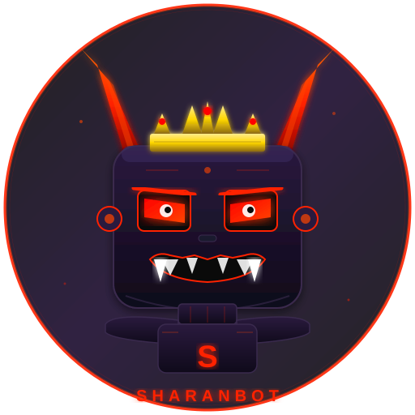

<div align="center">
  
  <h1>SharanBot — The Demon Boss of AI Agents</h1>
  <p><b>Autonomous. Self-Healing. Unstoppable.</b></p>
  <p>
    
    
    
    
    
    
    <a href="https://github.com/airajakathi/Sharanbot"></a>
  </p>
</div>

---

**SharanBot** is an autonomous AI agent framework that commands a team of 32 specialist agents, self-heals from any error, learns from its mistakes, and gets the job done — no hand-holding required.

Built for builders who want an AI that acts like a **demon boss**: fierce, relentless, and in total control.

## What Makes SharanBot Different

| | Traditional Bots | SharanBot |
|---|---|---|
| **Error Handling** | Crashes and waits | Self-heals, auto-recovers, learns |
| **Task Complexity** | Single-shot responses | DAG-based multi-agent orchestration |
| **Adaptability** | Static behavior | Self-learning + adaptive cooldowns |
| **Reliability** | Hope it works | Circuit breakers + 5-level retry |
| **Evolution** | Redeploy to update | Hot-reload everything at runtime |
| **Memory** | Forgets everything | Cross-session superhuman memory |
| **Credentials** | Plaintext config | Encrypted vault (PBKDF2 + Fernet) |
| **Monitoring** | Check logs manually | Real-time dashboard with WebSocket |
| **Browser** | External dependency | Native Tandem Browser with 24 MCP tools |

## Core Powers

### Multi-Agent Team Orchestration
Decomposes complex tasks into a DAG of subtasks, assigns specialist agents (architect, frontend, backend, devops, tester, security, data-engineer, and 25 more), and orchestrates parallel execution with quality gates.

### Self-Healing & Auto-Recovery
Never crashes permanently. The **RecoveryEngine** handles 8 error categories with circuit breakers:
- **Rate limits** → Adaptive exponential backoff (10-120s)
- **API errors** → 5-level retry (1, 2, 4, 8, 16s)
- **Tool failures** → Auto-retry with MCP reconnect
- **Stuck workers** → Health check + auto-restart
- **Gateway errors** → Circuit trip + graceful recovery
- **Timeouts** → Adaptive task timeout adjustment

### Self-Learning
The **LearningStore** remembers every error and every fix. Patterns are persisted to disk. SharanBot never makes the same mistake twice:
- Error signatures tracked with occurrence counts
- Successful fixes replayed automatically on matching errors
- Adaptive cooldowns via exponential moving average
- Cross-session persistence (survives restarts)

### Proactive Autopilot
Goes beyond reactive routing — the autopilot **anticipates** what you need:
- **Superhuman memory**: Cross-session user profiling (tracks your tasks, preferred strategies, peak hours, complexity trends)
- **Pattern caching**: Instant re-routing for similar tasks without LLM call
- **Memory-driven decisions**: Injects accumulated intelligence into routing analysis
- **Proactive suggestions**: Recommends next actions based on your workflow patterns
- **Learning-store-aware**: Avoids strategies that previously failed
- Routes to **direct** (simple) → **subagent** (moderate) → **full team** (complex)

### Encrypted Vault
Secure credential storage for API keys, tokens, and passwords:
- **PBKDF2** key derivation (480K iterations + SHA-256)
- **Fernet** symmetric encryption (AES-128-CBC + HMAC)
- Falls back to XOR obfuscation if `cryptography` isn't installed
- Master-password locked — credentials encrypted at rest
- Slash-path keys: `provider/openrouter/apiKey` → nested config overlay
- Persistent `vault.json` with encrypted entries

### Tandem Browser (Native)
SharanBot ships with **Tandem Browser** — a native Electron-based browser built for human-AI collaboration:

- **Human + AI shared browsing**: You browse normally, the AI agent watches and assists via the Wingman panel
- **24 MCP tools**: Navigate, click, type, screenshot, read pages, manage tabs, search bookmarks & history, create AI tasks with approval gates
- **Computer tool**: Coordinate-based visual automation (mouse, keyboard, screenshot) — available to all agents
- **OpenClaw Bridge**: WebSocket server on port `18789` linking SharanBot to the Wingman chat panel
- **Tandem API**: REST + SSE API on port `8766` with 250+ endpoints for full browser control
- **8-layer security**: Network shield, credential leak scanning, AST-level JS analysis, human-in-the-loop approval
- **Native dashboard panel**: Real-time SharanBot dashboard embedded directly in the Wingman panel (WebSocket-powered, no iframe)
- **Liquid Glass Lite**: Dark-themed UI with glass effects and smooth animations

### Real-Time Dashboard
Live web dashboard showing everything SharanBot is doing:
- **7 tabs**: Overview, Services, Teams, Health, Integrations, Projects, Logs
- **WebSocket**: Auto-reconnecting real-time updates every 3 seconds
- **Service monitoring**: Running apps, monitors, agents with status badges
- **Team tracking**: Active teams with task progress (completed/total)
- **Health view**: Circuit breaker visualization (closed/open)
- **Learning summary**: Patterns learned, successful fixes by category
- **Integration overview**: MCP servers, tools, skills, agent profiles, pipelines, plugins
- **Project browser**: Workspace project discovery with file viewer and one-click run
- **Activity log**: Live timestamp-tagged events
- Available at `http://127.0.0.1:18795` (configurable) and natively inside the Tandem Browser Wingman panel

### Autonomous Service Manager
Run and monitor long-lived services, deployed apps, and autonomous agents:
- **Lifecycle management**: Register → Start → Running → Stop/Restart/Remove
- **Auto-restart**: Dead processes detected and restarted (configurable max restarts)
- **Health checks**: Periodic process monitoring with status tracking
- **Log buffering**: 500-line circular buffer per service, accessible via API
- **Persistence**: Service configs saved to `services.json`, restored on restart
- Service kinds: `app` | `agent` | `monitor` | `cron` | `custom`

### Self-Evolution
Hot-reload at runtime without restart:
- Tools, plugins, agent profiles
- MCP servers, worker types
- Channel configurations

## Quick Start

### 1. Clone & Install

```bash
git clone https://github.com/airajakathi/Sharanbot.git
cd Sharanbot
pip install -e .

# Optional: for encrypted vault
pip install cryptography
```

### 2. Configure

```bash
sharanbot onboard
```

Edit `~/.sharanbot/config.json`:

```json
{
  "providers": {
    "custom": {
      "apiKey": "your-api-key",
      "apiBase": "https://api.your-provider.com/v1",
      "api": "openai-completions"
    }
  },
  "agents": {
    "defaults": {
      "model": "your-model-name",
      "provider": "custom"
    }
  },
  "dashboard": {
    "enable": true,
    "host": "127.0.0.1",
    "port": 18795
  }
}
```

### 3. Run

```bash
# CLI mode — interactive chat
sharanbot agent

# Gateway mode — connects to Telegram, Discord, etc.
# Also starts: dashboard, Tandem Browser, OpenClaw bridge
sharanbot gateway
```

## Supported Providers

| Provider | Type |
|----------|------|
| `custom` | Any OpenAI-compatible endpoint |
| `openrouter` | Access to all models |
| `anthropic` | Claude direct |
| `openai` | GPT direct |
| `deepseek` | DeepSeek direct |
| `gemini` | Gemini direct |
| `azure_openai` | Azure OpenAI |
| `groq` | LLM + Voice transcription |
| `moonshot` | Moonshot/Kimi |
| `ollama` | Local LLM |
| `vllm` | Local OpenAI-compatible |
| And 10+ more... | |

## Chat Channels

Connect SharanBot to 11 chat platforms:

| Channel | Connection |
|---------|-----------|
| **Telegram** | Bot token from @BotFather |
| **Discord** | Bot token + Message Content intent |
| **WhatsApp** | QR code scan |
| **Slack** | Socket Mode (no public IP needed) |
| **Feishu** | WebSocket (no public IP needed) |
| **DingTalk** | Stream Mode |
| **Email** | IMAP/SMTP |
| **QQ** | WebSocket |
| **Matrix** | E2EE supported |
| **Wecom** | WebSocket |
| **Mochat** | Socket.IO |

Example Telegram setup:
```json
{
  "channels": {
    "telegram": {
      "enabled": true,
      "token": "YOUR_BOT_TOKEN",
      "allowFrom": ["YOUR_USER_ID"]
    }
  }
}
```

## Agent Profiles

SharanBot includes **32 specialist agent profiles** (3 built-in + 29 plugin-based):

| Profile | Role |
|---------|------|
| `general` | Default all-purpose agent |
| `coder` | Coding-focused (extended iterations) |
| `researcher` | Read-only research with web access |
| `architect` | System design & architecture |
| `backend_dev` | Backend development |
| `frontend_dev` | Frontend development |
| `devops` | CI/CD & infrastructure |
| `security` | Security analysis & hardening |
| `tester` | Test writing & QA |
| `debugger` | Bug investigation |
| `code_reviewer` | Code review |
| `data_engineer` | Data pipeline design |
| `mcp_builder` | MCP server development |
| `orchestrator` | Multi-agent orchestration |
| `planner` | Task planning & decomposition |
| And 17 more... | (see `~/.sharanbot/workspace/plugins/agents/`) |

## Built-in Tools

| Tool | Description |
|------|-------------|
| `filesystem` | Read, write, edit, list, search files |
| `shell` | Execute shell commands |
| `web` | DuckDuckGo search + page fetch |
| `browser` | Playwright browser control |
| `tandem_browser` | Tandem Browser integration (24 MCP tools) |
| `computer` | Mouse, keyboard, screenshot automation |
| `wingman` | Wingman panel chat interaction |
| `sandbox` | Docker sandbox execution |
| `mcp` | Model Context Protocol tool bridge |
| `cron` | Scheduled task management |
| `spawn` | Subagent spawning |
| `worker` | Background worker task distribution |
| `message` | Cross-channel message delivery |
| `evolve` | Agent self-improvement |
| `reload` | Hot-reload tools & config |
| `dynamic` | Dynamic tool loading from workspace |
| `import_agent` | Import & compose agent code |

## Architecture

```
SharanBot
├── Gateway ──────────── Port 18790 (configurable)
│   ├── Agent Loop ───── LLM ↔ Tool execution cycle
│   │   ├── RecoveryEngine ─ Circuit breakers + auto-recovery
│   │   ├── LearningStore ── Persistent error memory
│   │   ├── Autopilot ────── Proactive routing + superhuman memory
│   │   └── Context ──────── System prompt + memory consolidation
│   ├── Team Orchestrator ─ DAG-based multi-agent execution
│   │   ├── 32 Agent Profiles
│   │   ├── Task Planner ──── LLM-powered decomposition
│   │   ├── Quality Gates ─── Output validation
│   │   └── Auto-Recovery ─── Task retry on failure
│   ├── Vault ─────────── Encrypted credential store (PBKDF2 + Fernet)
│   ├── Service Manager ── Autonomous service lifecycle
│   ├── Workers ───────── GSD-2 background processes
│   ├── Subagents ─────── Background task execution (3 nesting levels)
│   └── Self-Evolution ── Hot-reload everything at runtime
├── Dashboard ────────── Port 18795 — Real-time web UI (WebSocket)
├── Tandem Browser ───── Native Electron browser
│   ├── Wingman Panel ─── AI chat + activity + screenshots + dashboard
│   ├── OpenClaw Bridge ─ Port 18789 — WebSocket link to SharanBot
│   ├── Browser API ───── Port 8766 — REST + SSE (250+ endpoints)
│   ├── Computer Tool ─── Coordinate-based mouse/keyboard/screenshot
│   └── MCP Server ────── 24 browser automation tools
├── Tools ─────────────── 17 built-in tools + MCP extensions
├── Providers ─────────── 20+ LLM providers with 5-level retry
└── Channels ──────────── 11 chat platforms
```

## Ports Reference

| Port | Service | Protocol |
|------|---------|----------|
| `18790` | SharanBot Gateway | HTTP |
| `18795` | Dashboard | HTTP + WebSocket |
| `18789` | OpenClaw Bridge | HTTP + WebSocket |
| `8766` | Tandem Browser API | HTTP + SSE |

## Dashboard

The real-time dashboard runs alongside the gateway at `http://127.0.0.1:18795` and is also embedded natively in the Tandem Browser Wingman panel:

```
┌──────────────────────────────────────────────────┐
│  SHARANBOT                         [Connected]   │
│  ┌──────┬──────┬──────┬──────┐                   │
│  │  3   │  2   │  5   │  47  │                   │
│  │ Svcs │Teams │ Cron │Learn │                   │
│  └──────┴──────┴──────┴──────┘                   │
│                                                   │
│  Services   │ Status  │ PID  │ Uptime            │
│  ──────────────────────────────                   │
│  my-app     │ running │ 1234 │ 2h 15m            │
│  monitor    │ running │ 5678 │ 1h 30m            │
│  worker-1   │ stopped │ —    │ —                  │
│                                                   │
│  Circuits: [*] LLM  [*] MCP  [*] Tools           │
└──────────────────────────────────────────────────┘
```

Dashboard API endpoints:
- `GET /api/status` — Full system snapshot
- `GET /api/services` — Service manager status
- `GET /api/teams` — Active team orchestrations
- `GET /api/workers` — Worker manager status
- `GET /api/cron` — Scheduled cron jobs
- `GET /api/health` — Recovery engine + circuit breakers
- `GET /api/vault/keys` — Vault credential keys (no values)
- `GET /api/projects` — Workspace projects
- `GET /api/integrations` — MCP servers, tools, skills, profiles, pipelines, plugins
- `WS /ws` — Real-time WebSocket updates (3s interval)

## MCP (Model Context Protocol)

SharanBot supports MCP for extended tool capabilities:

```json
{
  "mcpServers": {
    "filesystem": {
      "command": "npx",
      "args": ["-y", "@anthropic/mcp-filesystem"]
    },
    "memory": {
      "command": "npx",
      "args": ["-y", "@anthropic/mcp-memory"]
    }
  }
}
```

Tandem Browser provides 24 MCP tools out of the box for browser automation — no additional configuration needed.

## Docker

```bash
docker build -t sharanbot .
docker run -v ~/.sharanbot:/root/.sharanbot --rm sharanbot onboard
docker run -v ~/.sharanbot:/root/.sharanbot -p 18790:18790 -p 18795:18795 sharanbot gateway
```

Docker Compose:
```bash
docker compose up -d sharanbot-gateway
```

## Project Structure

```
sharanbot/
├── agent/                 # Core agent logic
│   ├── loop.py            # Agent loop (LLM ↔ tools)
│   ├── recovery.py        # Auto-recovery engine + circuit breakers
│   ├── learning.py        # Self-learning store (JSONL persistence)
│   ├── context.py         # System prompt builder
│   ├── memory.py          # Persistent memory + consolidation
│   ├── subagent.py        # Background subagent execution
│   ├── worker.py          # Worker manager + health checks
│   ├── profiles.py        # Agent profile loader
│   ├── team/              # Multi-agent orchestration
│   │   ├── orchestrator.py
│   │   ├── dag.py         # Task dependency graph
│   │   ├── planner.py     # LLM-powered decomposition
│   │   ├── quality.py     # Quality gates
│   │   └── autopilot.py   # Proactive routing + superhuman memory
│   └── tools/             # 17 built-in tools
│       ├── filesystem.py  # Read/write/edit/list
│       ├── shell.py       # Command execution
│       ├── web.py         # Search & fetch
│       ├── browser.py     # Playwright control
│       ├── computer.py    # Mouse/keyboard/screenshot
│       ├── tandem_browser.py # Tandem Browser MCP integration
│       ├── wingman.py     # Wingman panel interaction
│       ├── sandbox.py     # Docker sandbox
│       └── mcp.py         # MCP protocol bridge
├── tandem/                # Tandem Browser integration
│   ├── manager.py         # Electron process lifecycle
│   └── openclaw_bridge.py # WebSocket bridge (port 18789)
├── vault/                 # Encrypted credential store
├── services/              # Autonomous service manager
├── dashboard/             # Real-time web UI + WebSocket
├── providers/             # 20+ LLM providers
├── channels/              # 11 chat platforms
├── config/                # Config + hot-reload
└── cli/                   # CLI commands
tandem-browser/            # Native Electron browser (inbuilt)
├── main/                  # Electron main process
├── shell/                 # Browser shell (HTML/CSS/JS)
│   ├── index.html         # Main shell with Wingman panel
│   ├── js/                # Tab management, sidebar, wingman, dashboard
│   └── css/               # Liquid Glass Lite design system
├── api/                   # REST + SSE API (port 8766)
├── mcp/                   # 24 MCP tools for browser automation
└── package.json           # Electron app config (v0.65.5)
```

## Contributing

PRs welcome. The codebase is intentionally small and readable.

See [CONTRIBUTING.md](./CONTRIBUTING.md) for guidelines and [SECURITY.md](./SECURITY.md) for security policy.

## License

MIT — see [LICENSE](./LICENSE).

---

<div align="center">
  <p><b>SharanBot doesn't ask for permission. It gets the job done.</b></p>
  <p>
    <a href="https://github.com/airajakathi/Sharanbot">
      
    </a>
  </p>
</div>
